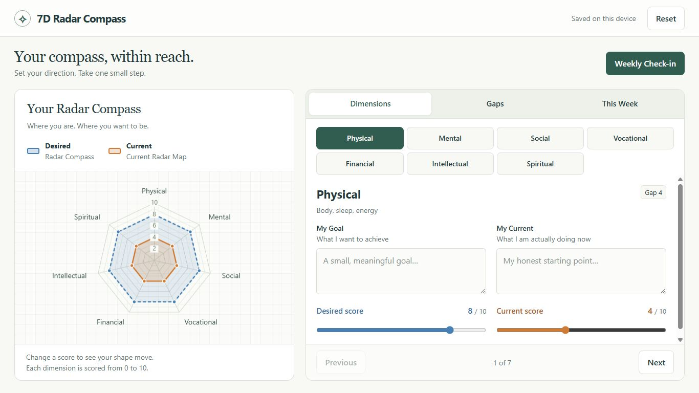

# 7D Radar Compass

A simple visual tool for getting clear about where you want to be, seeing where you are now, and closing the gap with small weekly actions.

[Report a bug](https://github.com/ahmadxon5678/7D_radar_compass/issues) · [Contribute](CONTRIBUTING.md)

**Web version:** GitHub Pages still needs to be enabled. Once enabled, the app will be at [ahmadxon5678.github.io/7D_radar_compass](https://ahmadxon5678.github.io/7D_radar_compass/). You can already download the app or run it locally using the steps below.

Inspired by Karim Atassi's 7D Framework, as described in [this reel](https://www.instagram.com/reel/Df-8PNbAgkq/). This is an independent implementation, not an official or affiliated app.



## What it does

- Compares Desired (blue) and Current (orange) scores on a live radar chart.
- Covers seven fixed dimensions: Physical, Mental, Social, Vocational, Financial, Intellectual, and Spiritual.
- Gives each dimension a goal, an honest description of what you currently do, and two scores from 0 to 10.
- Sorts gaps from largest to smallest. Click a gap to edit that dimension.
- Lets you plan one small action for each day and mark it done.
- Saves weekly check-ins with a snapshot of your scores, goals, and actions.
- Saves changes automatically in your browser, with no account or backend.

The desktop layout keeps the radar beside the editor. On phones, a fixed bottom bar switches between Compass, Dimensions, Gaps, and This Week. Day buttons open any day's action directly.

## The seven dimensions

| Dimension | Examples to reflect on |
| --- | --- |
| Physical | Body, sleep, energy |
| Mental | Emotions, calm, resilience |
| Social | Friends, family, connection |
| Vocational | Work, craft, contribution |
| Financial | Money, saving, stability |
| Intellectual | Learning, curiosity, skills |
| Spiritual | Meaning, values, reflection |

Scores are your own assessment, not an objective rating. The starting scores (Desired 8, Current 4) are placeholders; change them to reflect your own situation. A positive gap is an area you want to bring closer to your goal; a negative gap means Current exceeds Desired.

## Run locally

With Node.js 18 or newer installed:

```sh
git clone https://github.com/ahmadxon5678/7D_radar_compass.git
cd 7D_radar_compass
npm start
```

Open **http://localhost:8765**. No dependency installation or build step is needed. Stop the server with Ctrl+C.

You can also download `index.html` and open it directly in a browser. The app is entirely contained in that file and works offline. A localhost server gives browser storage a consistent origin.

## Weekly routine

1. Choose a dimension and write your goal and current activity.
2. Adjust Desired and Current scores. Watch the chart and gap ranking update.
3. Open This Week and give each day one small, specific action.
4. Tick actions as you finish them.
5. Use Weekly Check-in to re-rate Current scores and save a snapshot.
6. Use Clear Week to start fresh. Your goals, scores, and saved check-ins remain.

Reset clears all app data in the current browser after confirmation.

## Your data

Goals, scores, actions, and check-in snapshots stay in `localStorage` in your browser. The app does not upload them, use analytics, or sync them between devices. Saved check-ins are retained locally; the interface shows the latest check-in date and total count.

Different browsers, devices, addresses, and ports have separate storage. Moving from the downloaded file to localhost or the public site will not automatically transfer existing entries. Clearing browser site data removes your saved work. Private browsing and restricted storage settings may prevent saving.

## Troubleshooting

- **The port is busy:** stop an existing server, or use `PORT=8766 npm start` on macOS/Linux. In PowerShell, run `$env:PORT=8766; npm start`. Changing the port also changes the storage origin.
- **Saving is unavailable:** use a regular browser window with site storage allowed. A warning appears in the header if localStorage cannot be written.
- **My previous entries are missing:** open the same address, port, and browser where you originally entered them. Data is not automatically transferred between the standalone file, localhost, and GitHub Pages.
- **The week has changed:** use Clear Week when ready. The planner does not automatically erase unfinished actions or roll over at midnight.
- **Where are earlier check-ins?** snapshots are stored locally. The interface currently shows the latest check-in date and total count; it does not include a history browser or export feature.

## Hosting and development

To publish with GitHub Pages:

1. Open repository **Settings → Pages** (repository administrators only).
2. Under Build and deployment, set **Source** to **Deploy from a branch**.
3. Select **main** and **/ (root)**, then click **Save**.
4. Wait for the Pages build to complete. GitHub will show the public website link on that settings page.

After Pages is enabled, pushes to `index.html` update the site. `.nojekyll` keeps it a plain static site.

The radar is drawn with Canvas. There are no third-party libraries, CDNs, fonts, or services. `server.mjs` is only a small static file server for local use; the app needs no server-side application logic.

Suggestions and improvements are welcome through GitHub issues and pull requests. See [CONTRIBUTING.md](CONTRIBUTING.md) for the development workflow and checks.

## License

MIT. You may use, modify, and share this implementation. Attribution to the framework's creator above describes the inspiration and does not claim ownership of the framework or reel.
